# Exploration des données (EDA) — release `g1-v1.0`

Généré automatiquement par `05_eda.py` — tous les chiffres viennent de `stats.json`.

## 1. Tailles

| split | images | captions |
|---|---|---|
| kb | 10000 | 50000 |
| val | 100 | 500 |
| test | 100 | 500 |

## 2. Objets & complexité

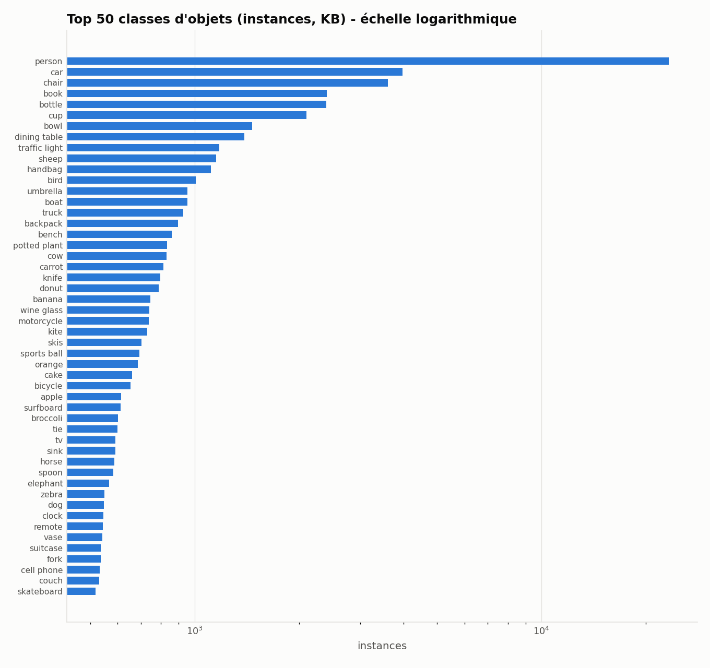

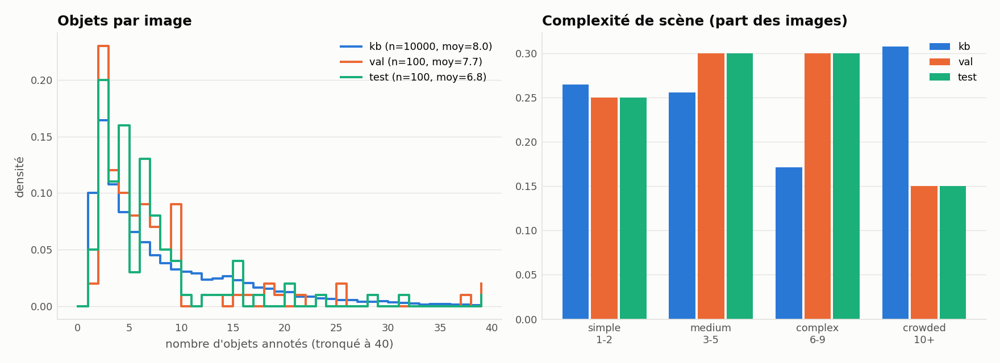

| split | objets/image (moy) | médiane | p90 | max | catégories/image |
|---|---|---|---|---|---|
| kb | 8.05 | 5.0 | 19.0 | 67 | 3.25 |
| val | 7.74 | 5.0 | 18.0 | 65 | 3.41 |
| test | 6.77 | 4.0 | 15.0 | 62 | 3.30 |

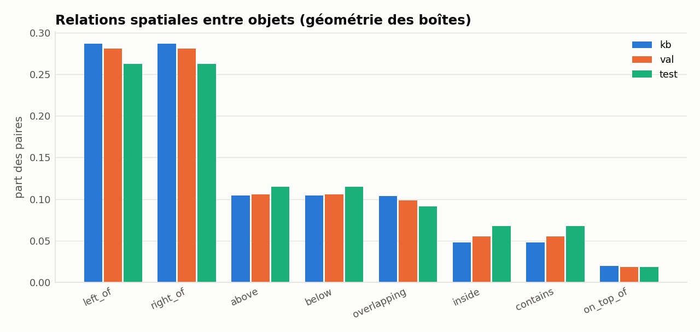

## 3. Texte

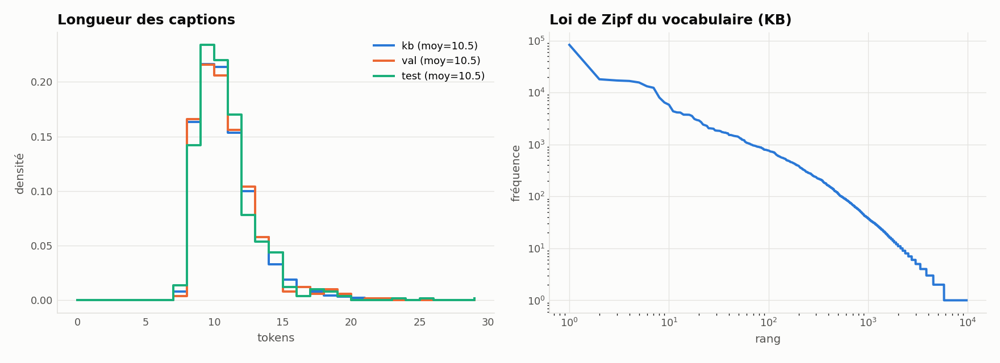

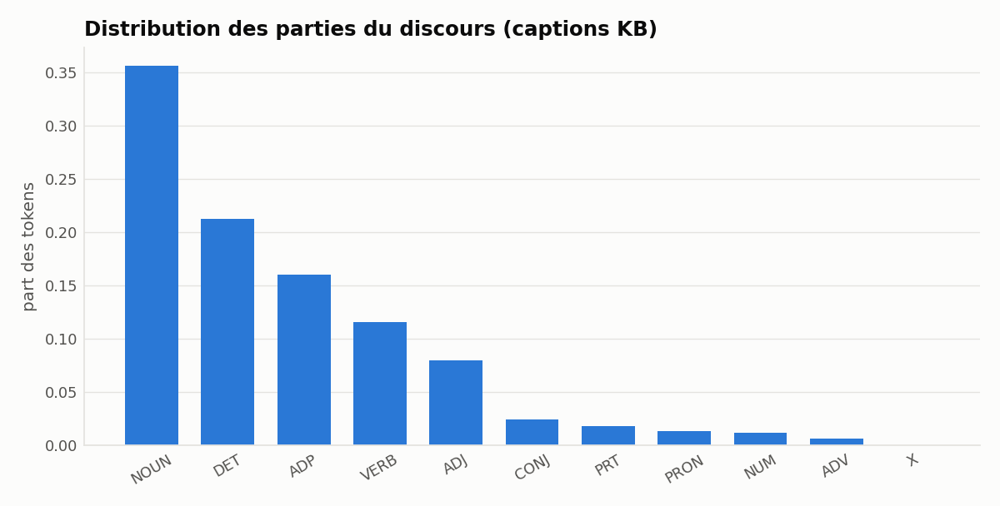

| split | longueur moy. | vocabulaire | hapax | TTR |
|---|---|---|---|---|
| kb | 10.48 | 9697 | 3936 | 0.0185 |
| val | 10.49 | 967 | 499 | 0.1844 |
| test | 10.47 | 924 | 458 | 0.1765 |

OOV test vs KB : 0.74 % des tokens ; val vs KB : 1.09 %.

## 4. Co-occurrence & lien image/texte

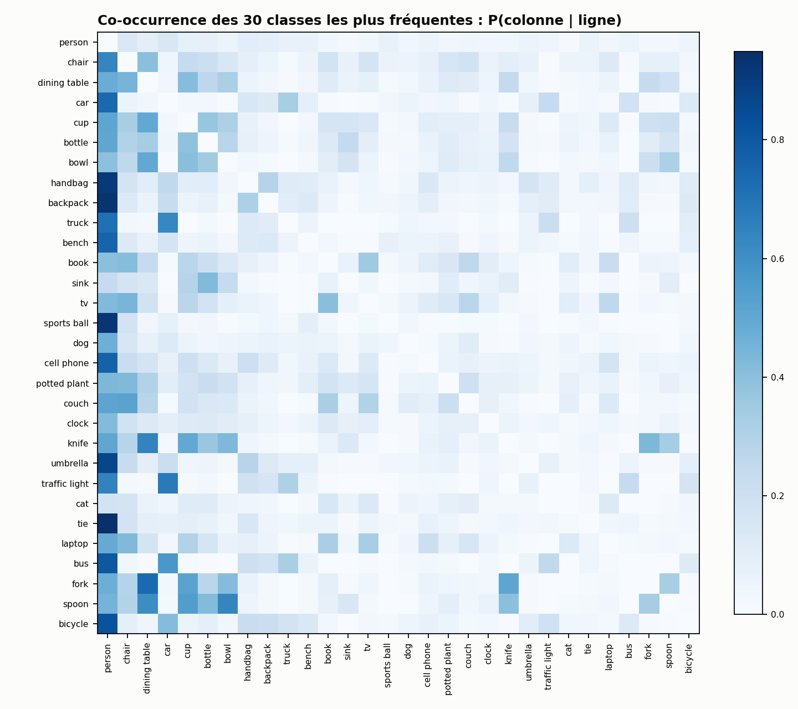

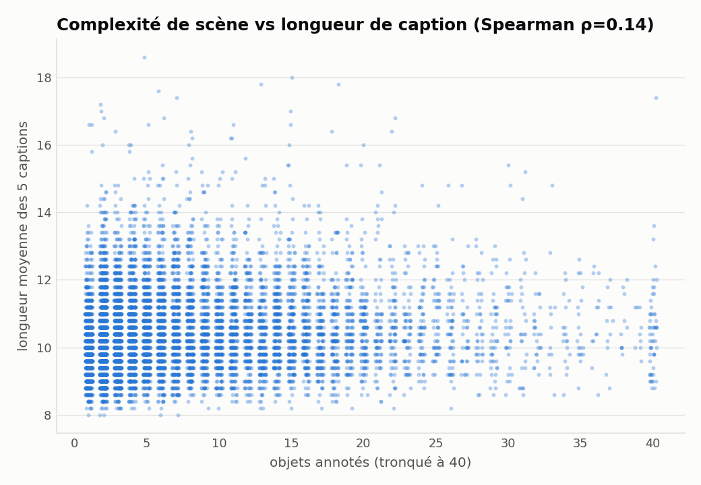

## 5. Diversité (contexte, lumière, couleurs, attributs)

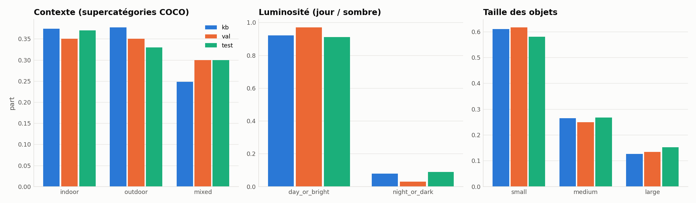

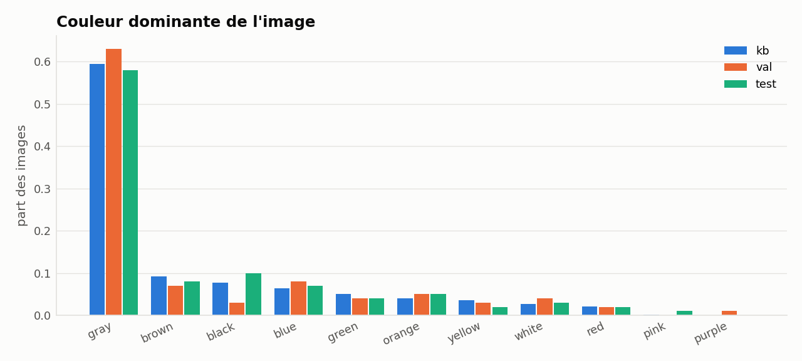

## 6. Représentativité des splits

- JS divergence (distribution des classes) : KB↔val = 0.0311, KB↔test = 0.0313
- KS longueur de caption KB↔test : D=0.025, p=0.913
- χ² complexité KB↔test : p=0.000376 (écart attendu : le test est volontairement ÉQUILIBRÉ (stratifié), la KB reste naturelle)
- Classes manquantes dans le test : aucune

## 7. Planche qualitative

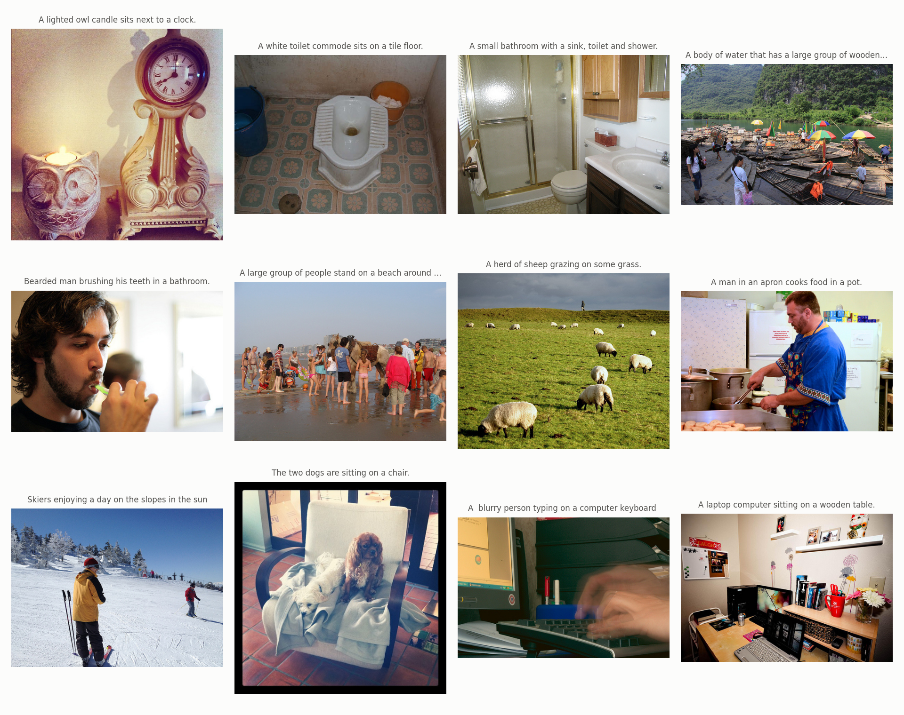

## 8. Attributs de couleur et de forme (captions KB)

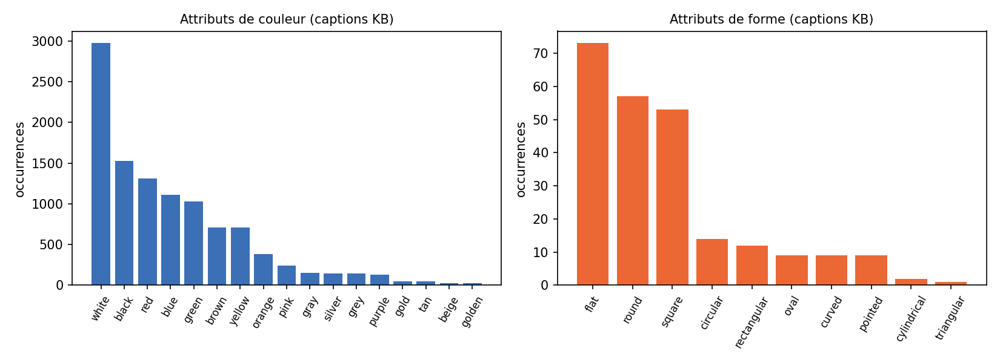

Formes les plus fréquentes : flat (73), round (57), square (53), circular (14), rectangular (12), oval (9).
